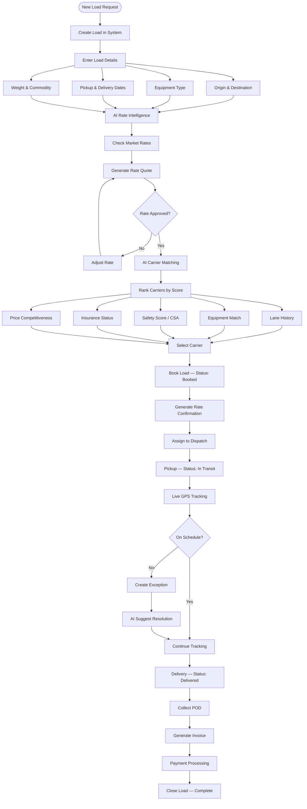
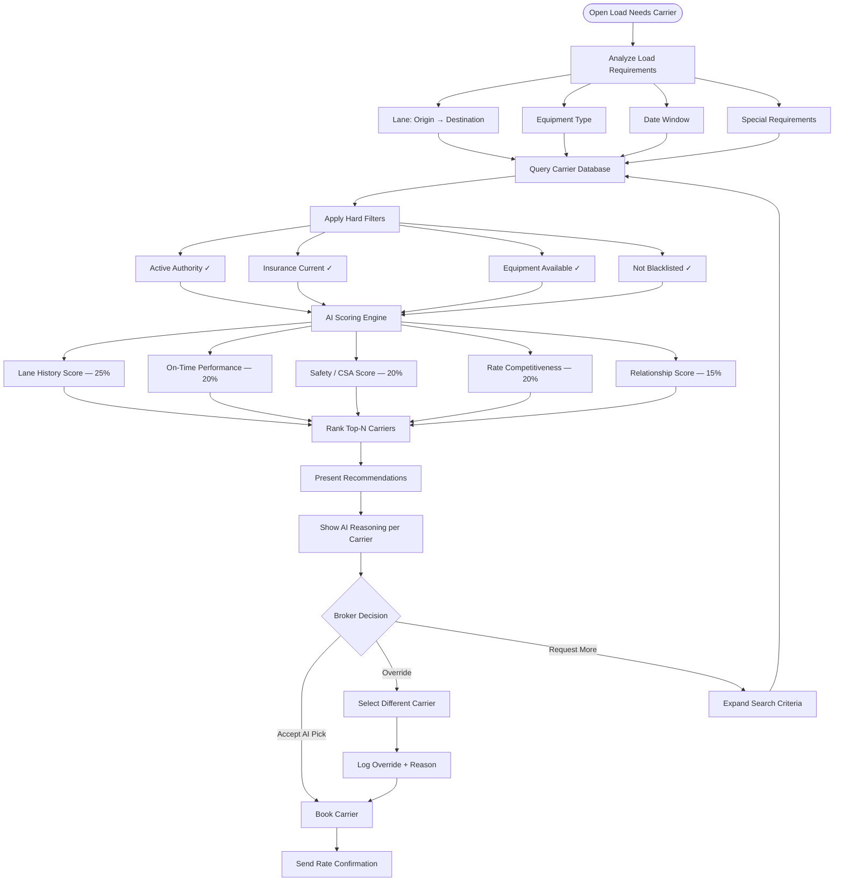
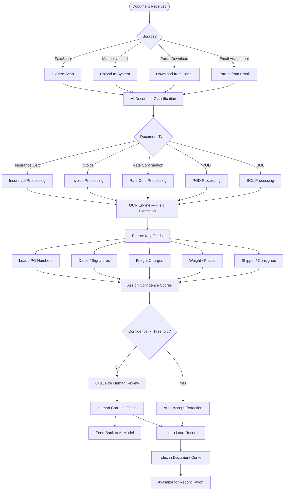
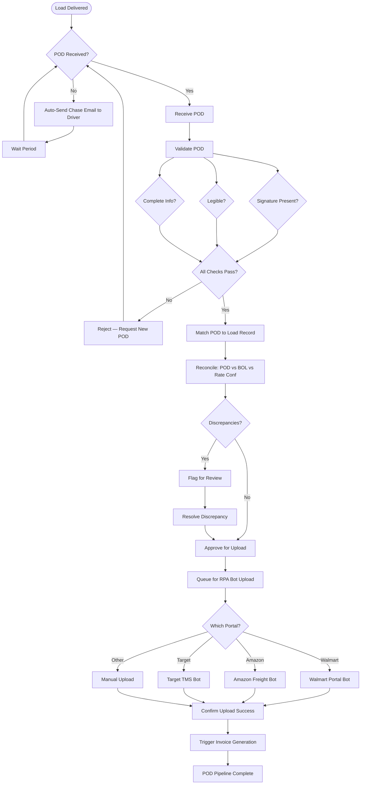
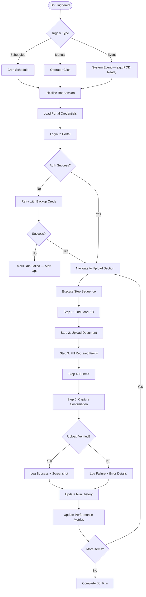
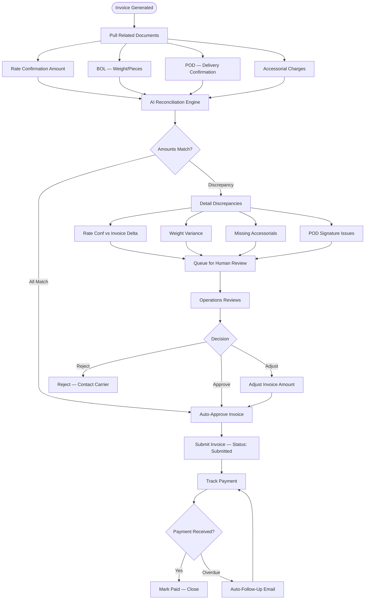
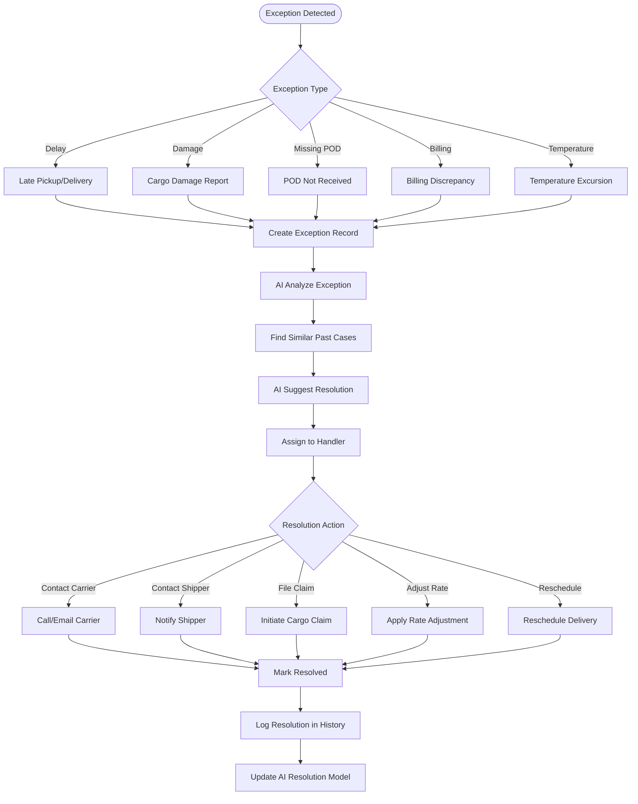
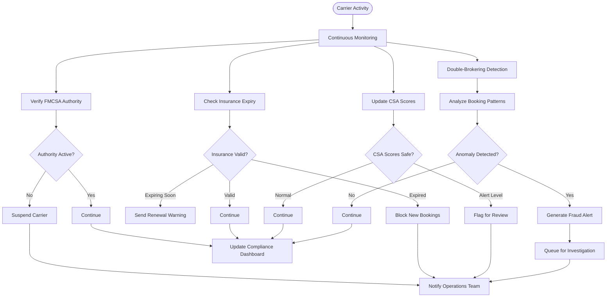
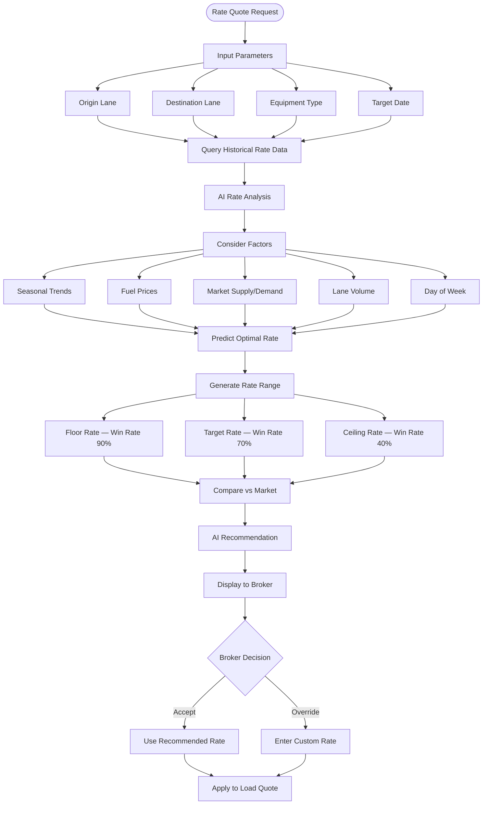

# FreightIQ — Process Flow Diagrams

## 1. Load Lifecycle Flow

## 2. AI Carrier Matching Flow

## 3. Document Intelligence & OCR Flow

## 4. POD Collection & Portal Upload Flow

## 5. RPA Bot Execution Flow

## 6. Invoice Reconciliation Flow

## 7. Exception Management Flow

## 8. Compliance & Fraud Detection Flow

## 9. Rate Intelligence Flow

