# FreightIQ — Product Overview

## Product Identity

| Field | Details |
|-------|---------|
| **Product Name** | FreightIQ |
| **Tagline** | AI-Powered Freight Brokerage Operations — Automate, Match, Deliver |
| **Category** | SaaS · Logistics · Freight Tech · Supply Chain Automation |
| **Built By** | Signity Solutions |

---

## Problem Statement

Freight brokerages face compounding operational bottlenecks:

1. **Manual Load Matching** — Brokers spend hours calling carriers, checking rates, and matching loads to trucks. AI-powered matching can compress this to seconds.
2. **Document Chaos** — BOLs, PODs, rate confirmations, and insurance certificates flow through email, fax, and portals with no unified system. Manual data entry causes billing delays and compliance gaps.
3. **Portal Fragmentation** — Shippers like Walmart, Amazon, and Target each have proprietary portals with different login flows and document requirements. Agents manually upload PODs to each — a tedious, error-prone process ripe for RPA automation.
4. **Rate Volatility** — Spot rates fluctuate hourly by lane, season, and market conditions. Without AI-driven rate intelligence, brokers leave margin on the table or lose bids.

---

## Target Audience

- **Freight Brokerages** (small to mid-market, 10–500 loads/day)
- **3PL Companies** managing multi-modal transportation
- **Logistics Operations Managers** seeking automation and visibility
- **Freight Tech Startups** needing a ready-built operations platform

---

## Complete Feature List

### 1. Operations Dashboard
- 4 KPI cards: Active Loads, Revenue, On-Time %, Exception count
- 14-day loads trend area chart
- Revenue-by-lane bar chart
- Carrier on-time performance chart
- AI insight cards with actionable recommendations
- Recent loads table with status indicators
- Active exceptions list
- Automation snapshot (bot activity summary)

### 2. Load Board & Management
- 58 loads with full lifecycle tracking
- Search by Load ID, origin, destination
- Filter by status (Booked, In Transit, Delivered, Exception) and shipper
- Per-load detail page with:
  - Timeline (booked → picked up → in transit → delivered)
  - Lane info (origin/destination/miles)
  - Rate breakdown (line haul, fuel surcharge, accessorials)
  - Document upload (BOL, POD, Rate Confirmation)
  - Exception history
  - Live ETA with driver and temperature tracking
  - AI confidence score

### 3. Dispatch & Live Tracking
- Stylized US map with clickable load position dots (green/amber/red by ETA status)
- Side panel with load detail and progress bar
- Mock GPS integration (Samsara / Motive ELD)
- Real-time ETA updates

### 4. Carrier Management
- Carrier directory with search by name or MC#
- Equipment type filter (dry van, reefer, flatbed, etc.)
- AI score bars per carrier
- Insurance and compliance status indicators
- Per-carrier detail page:
  - Performance line chart (on-time trend)
  - CSA safety score bars (Unsafe Driving, HOS, Driver Fitness, Vehicle Maintenance)
  - Document management
  - Contact list
  - Lane history

### 5. AI Carrier Matching
- Automated carrier recommendations for open loads
- Demo: Chicago → LA load with 6 ranked carriers
- Per-carrier: Match score, quoted rate, ETA confidence
- Expandable AI reasoning for each recommendation
- Factors: lane history, equipment match, insurance, safety scores

### 6. Document Intelligence
- 36 documents across 5 types (BOL, POD, Rate Confirmation, Invoice, Insurance)
- OCR processing with validation status
- Per-document detail showing extracted fields with confidence scores
- Automated field extraction (shipper, consignee, weight, pieces, freight charges)

### 7. POD Manager
- KPI counts for POD pipeline
- Kanban view: Awaiting Delivery → Received → Validated → Submitted → Complete
- Validation checks: signature present, legibility score, completeness
- Per-portal bot upload status (Walmart, Amazon, Target portals)
- Automated POD-to-invoice matching

### 8. RPA Bot Manager
- **4 tabs**: Active Runs, Bot Library, Run History, Performance
- **8 bots**: Walmart Portal, Amazon Freight, Target TMS, Home Depot, TMS Sync, QuickBooks, Insurance Verify, FMCSA Lookup
- Step-by-step run logs with progress visualization
- Success-rate line chart over time
- Documents-per-day bar chart
- Bot scheduling and manual trigger

### 9. AI Command Center
- 6 AI model cards with accuracy percentage and confidence threshold
- Weekly accuracy trend line chart
- 54-entry decision log with:
  - Expandable AI reasoning
  - Override tracking (when humans overrode AI decisions)
  - Model version and confidence score per decision

### 10. Invoice Center
- 44 invoices with status tabs (All, Draft, Submitted, Paid, Overdue)
- AI reconciliation panel comparing:
  - Rate Confirmation amount vs. Invoice amount vs. POD data
  - Automatic discrepancy flagging
- Invoice detail with line items and payment history

### 11. Rate Intelligence
- AI rate calculator with inputs: origin lane, destination lane, equipment type, date
- Market trend line chart (historical rates for the lane)
- Seasonal factor bar chart
- Your-rate-vs-market comparison table
- AI pricing recommendations with confidence interval

### 12. Analytics & Reporting
- Revenue and margin trend charts
- Exception distribution pie chart
- Lane profitability analysis
- Day-by-hour activity heatmap
- Top carriers by volume and performance
- Payment cycle analysis
- AI model performance metrics
- RPA bot productivity metrics
- 7 standard report templates with Download/Email/Schedule actions

### 13. Communication Hub
- Unified inbox across email, SMS, and portal notifications
- Tabs: All, Carriers, Shippers, Drivers, Automated
- AI-suggested reply drafts
- "Send as-is" quick action with template dropdown
- Conversation threading

### 14. Compliance Center
- Compliance KPI tiles
- Fraud alerts (double-brokering detection)
- Insurance renewal tracking with expiration warnings
- Carrier compliance table with CSA scores
- FMCSA integration for authority verification

### 15. Exception Manager
- 18 exceptions across 5 types (delay, damage, missing POD, billing, temperature)
- Detail panel per exception
- AI-suggested resolutions
- Similar past cases analysis
- Resolution tracking and escalation workflow

### 16. Integration Hub
- Integration cards in 6 categories:
  - TMS (McLeod, Tai, Mercury Gate)
  - Load Boards (DAT, Truckstop, 123Loadboard)
  - ELD/GPS (Samsara, Motive, KeepTruckin)
  - Accounting (QuickBooks, SAP)
  - Shipper Portals (Walmart, Amazon, Target, Home Depot)
  - Communication (Twilio, SendGrid)
- Connection status, last sync time, data direction, error count

### 17. Shipper Management
- 15 shippers (Walmart, Amazon, Target, Costco, Home Depot, etc.)
- Per-shipper detail: portal type/status, payment terms, rate agreement, on-time requirement
- YTD revenue per shipper
- Compliance requirements per shipper

### 18. Settings & Administration
- 7 tabs: Tenant, Users, Credentials, Notifications, AI Thresholds, Bot Schedules, Billing
- 5-user team: Alex Singh, Priya Raman, Jordan Klein, Samira Ali, Chen Li
- Portal credential management (masked)
- AI confidence threshold configuration per model
- Bot scheduling configuration
- Enterprise subscription display

### 19. Marketing Website
- Static HTML site with pages: Home, Features, For Brokers, For Carriers, Automation, Pricing, Case Studies, About
- "Request Demo" CTA
- Feature showcases and customer testimonials

---

## POC Tech Stack

| Layer | Technology |
|-------|-----------|
| Frontend Framework | React 19 |
| Build Tool | Vite 8 |
| Routing | React Router DOM 7 |
| Styling | Tailwind CSS 3 |
| Charts | Recharts 3 |
| Icons | Lucide React |
| Theme | Dark/Light toggle (localStorage) |
| Backend | None — all mock/seed data in JS |

## Production Tech Stack Recommendation

| Layer | Recommended Technology |
|-------|----------------------|
| Frontend | Next.js 15 (SSR + API routes) |
| Backend | Node.js + NestJS (microservices) |
| Database | PostgreSQL (loads, carriers, shippers) + TimescaleDB (rate history) |
| Cache | Redis (session, real-time tracking, rate cache) |
| AI/ML | OpenAI GPT-4 (decision reasoning, document extraction), custom ML models (rate prediction, carrier matching) |
| OCR | Google Document AI or AWS Textract (BOL/POD extraction) |
| RPA | Playwright / Puppeteer (portal automation bots) |
| Real-Time | Socket.IO or Ably (live tracking, dispatch map) |
| GPS/ELD | Samsara API, Motive API (real-time truck positions) |
| Message Queue | RabbitMQ or AWS SQS (bot job queue, async document processing) |
| Storage | AWS S3 (documents, PODs, images) |
| Auth | Auth0 or Clerk (multi-tenant, role-based) |
| Mapping | Mapbox GL JS (dispatch map with real geocoding) |
| Search | Elasticsearch (loads, documents, carriers) |
| Infrastructure | AWS ECS (microservices) + RDS + ElastiCache + S3 |
| CI/CD | GitHub Actions → AWS CodePipeline |

---

## Architecture Diagram

```mermaid
graph TB
    subgraph "External Systems"
        TMS_EXT[TMS — McLeod / Tai]
        LB[Load Boards — DAT / Truckstop]
        ELD[ELD/GPS — Samsara / Motive]
        SP[Shipper Portals — Walmart / Amazon / Target]
        ACCT[Accounting — QuickBooks / SAP]
        COMM_EXT[Twilio / SendGrid]
    end

    subgraph "FreightIQ Platform"
        GW[API Gateway]
        
        subgraph "Core Services"
            LOAD[Load Management Service]
            CARRIER[Carrier Management Service]
            DISPATCH[Dispatch & Tracking Service]
            DOC[Document Intelligence Service]
            INV[Invoice & Billing Service]
            COMP[Compliance Service]
            MSG[Communication Service]
        end
        
        subgraph "AI Layer"
            MATCH[AI Carrier Matching Engine]
            RATE[Rate Intelligence Engine]
            OCR[OCR & Document Extraction]
            EXCEPT[Exception Resolution AI]
            FRAUD[Fraud Detection — Double Brokering]
            DECISION[AI Decision Logger]
        end
        
        subgraph "Automation Layer"
            BOT_MGR[RPA Bot Manager]
            WMT_BOT[Walmart Portal Bot]
            AMZ_BOT[Amazon Freight Bot]
            TGT_BOT[Target TMS Bot]
            QB_BOT[QuickBooks Sync Bot]
            INS_BOT[Insurance Verify Bot]
        end
        
        subgraph "Data Layer"
            PG[(PostgreSQL)]
            TS[(TimescaleDB — Rates)]
            REDIS[(Redis Cache)]
            ES[(Elasticsearch)]
            S3[(S3 — Documents)]
        end
    end

    subgraph "Dashboard"
        OPS[Operations Dashboard]
        ANALYTICS[Analytics & Reports]
        AI_CMD[AI Command Center]
        SETTINGS[Settings & Admin]
    end

    TMS_EXT & LB --> GW
    ELD --> DISPATCH
    SP --> BOT_MGR
    ACCT --> INV
    COMM_EXT --> MSG
    
    GW --> LOAD & CARRIER
    LOAD --> MATCH
    LOAD --> RATE
    DOC --> OCR
    LOAD --> DISPATCH
    DISPATCH --> ELD
    DOC --> INV
    CARRIER --> COMP
    COMP --> FRAUD
    MATCH & RATE & OCR & EXCEPT --> DECISION
    
    BOT_MGR --> WMT_BOT & AMZ_BOT & TGT_BOT & QB_BOT & INS_BOT
    
    LOAD & CARRIER & DISPATCH & DOC & INV --> PG
    RATE --> TS
    DISPATCH --> REDIS
    LOAD & DOC --> ES
    DOC --> S3
    
    OPS & ANALYTICS & AI_CMD & SETTINGS --> GW
```

---

## Demo Credentials

| Field | Value |
|-------|-------|
| **Login** | No login page — app loads directly |
| **Demo User** | Alex Singh, Ops Manager |
| **Tenant** | Signity Solutions |
| **Tenant ID** | `signity-freight-prod` |
| **Team** | Alex Singh, Priya Raman, Jordan Klein, Samira Ali, Chen Li |

---

## Key Metrics (Demo Data)

| Metric | Value |
|--------|-------|
| Active Loads | 58 |
| Documents Managed | 36 |
| RPA Bots | 8 |
| AI Models | 6 |
| AI Decision Log | 54 entries |
| Invoices | 44 |
| Shippers | 15 |
| Exceptions Tracked | 18 |
| Integrations | 18 (across 6 categories) |
| Report Templates | 7 |
